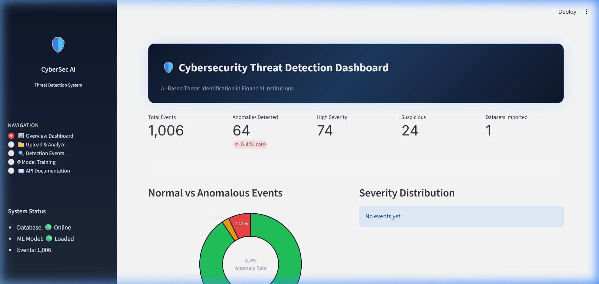
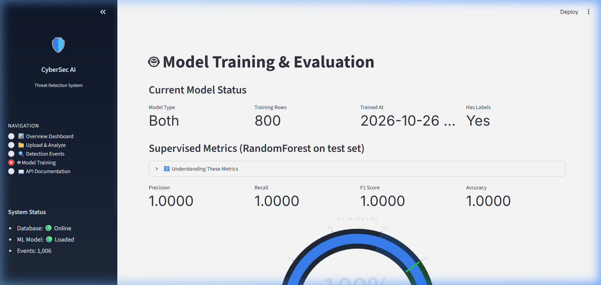
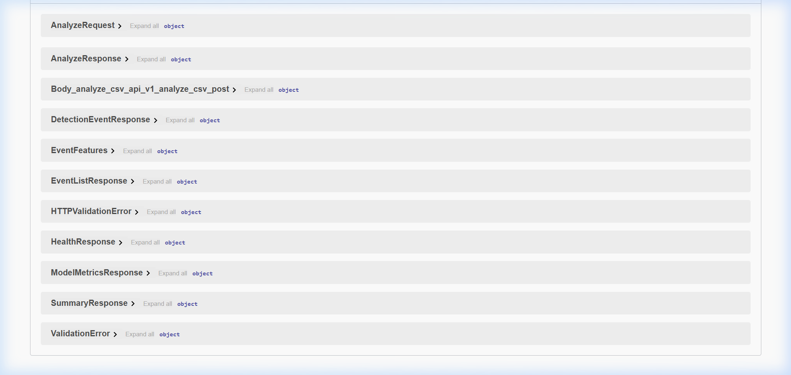

# 🛡️ AI-Based Cybersecurity Threat Detection System for Financial Institutions

> **An enterprise-grade, end-to-end Machine Learning security pipeline combining unsupervised anomaly detection (IsolationForest) and supervised classification (RandomForest) to detect network intrusions, brute-force authentication attacks, and data exfiltration.**

[](https://python.org)
[](https://fastapi.tiangolo.com)
[](https://streamlit.io)
[](https://scikit-learn.org)
[](https://www.sqlite.org/)
[](https://pytest.org)
[](LICENSE)

---

## 📌 Executive Summary

Modern financial institutions process millions of authentication and network transactions every minute. Conventional signature-based Intrusion Detection Systems (IDS) rely heavily on known threat signatures and rigid thresholds, resulting in high false-positive rates and an inability to detect novel zero-day threats.

This project delivers a **production-ready, locally runnable Machine Learning Threat Detection System** designed specifically for financial security operations. By deploying a hybrid ML engine—coupling unsupervised **IsolationForest** (for zero-day anomaly discovery) with supervised **RandomForest** (for calibrated attack classification)—the system detects malicious behavior, calculates granular risk scores, assigns rule-based severities, and generates plain-English audit trails for security analysts.

---

## 🖼️ Application Showcase

### 1. Interactive Security Monitoring Dashboard
*Real-time security analytics displaying telemetry KPIs, severity distribution donuts, protocol breakdowns, and alert logs.*



---

### 2. Machine Learning Model Evaluation & Diagnostics
*Automated model evaluation reporting Precision, Recall, F1-Score, and anomaly detection distributions on incoming network streams.*



---

### 3. Interactive FastAPI REST API & OpenAPI Documentation
*Fully validated, asynchronous REST endpoints with automated Swagger UI for real-time inference, batch CSV uploads, and telemetry querying.*



---

## 🏛️ System Architecture & Data Flow

The application follows clean architecture principles with strict separation between data ingestion, machine learning preprocessing, model inference, persistence, and presentation layers:

```
                       ┌──────────────────────────────────────────────┐
                       │               DATA SOURCES                   │
                       │  • Live JSON API Stream   • CSV File Upload  │
                       └──────────────────────┬───────────────────────┘
                                              │
                                              ▼
                       ┌──────────────────────────────────────────────┐
                       │          INGESTION & VALIDATION              │
                       │             (app/services/ingestion.py)      │
                       │  • File format & size enforcement (≤ 10MB)   │
                       │  • Schema validation (Pydantic v2 schemas)   │
                       │  • Column normalization & type sanitization  │
                       └──────────────────────┬───────────────────────┘
                                              │
                                              ▼
                       ┌──────────────────────────────────────────────┐
                       │         PREPROCESSING PIPELINE               │
                       │       (app/services/preprocessing.py)        │
                       │  • Median imputation for missing metrics     │
                       │  • StandardScaler for high-variance features │
                       │  • OneHotEncoder for protocol categories     │
                       │  • Zero-leakage Scikit-learn Pipeline        │
                       └──────────────────────┬───────────────────────┘
                                              │
                                              ▼
                       ┌──────────────────────────────────────────────┐
                       │              HYBRID ML ENGINE                │
                       │         (app/services/detection.py)          │
                       │  ┌────────────────────┐ ┌──────────────────┐ │
                       │  │  IsolationForest   │ │  RandomForest    │ │
                       │  │   (Unsupervised)   │ │   (Supervised)   │ │
                       │  │ Anomaly Score < 0  │ │ Probability >=.7 │ │
                       │  └─────────┬──────────┘ └────────┬─────────┘ │
                       │            └──────────┬──────────┘           │
                       │                       ▼                      │
                       │            RULE-BASED SEVERITY ENGINE        │
                       │          [ High | Suspicious | Normal ]      │
                       │                       │                      │
                       │            AUDIT EXPLANATION ENGINE          │
                       │      Contextual Plain-English Alerts         │
                       └──────────────────────┬───────────────────────┘
                                              │
                                              ▼
                       ┌──────────────────────────────────────────────┐
                       │              PERSISTENCE LAYER               │
                       │         (app/database.py & SQLite)           │
                       │  • DetectionEvent: Telemetry + Model Verdict │
                       │  • DatasetImport: Ingestion audit history    │
                       │  • ModelRun: Training runs, F1 & params      │
                       └──────────────────────┬───────────────────────┘
                                              │
                       ┌──────────────────────┴──────────────────────┐
                       │                                             │
                       ▼                                             ▼
        ┌─────────────────────────────┐               ┌─────────────────────────────┐
        │      FASTAPI REST API       │               │     STREAMLIT DASHBOARD     │
        │      (Port 8000)            │               │      (Port 8501)            │
        │  • Swagger UI (/docs)       │               │  • Executive KPI Cards      │
        │  • Single & Batch Inference │               │  • Anomaly Trend Visuals    │
        │  • Health & Model Metrics   │               │  • CSV Drag-and-Drop        │
        └─────────────────────────────┘               └─────────────────────────────┘
```

---

## ✨ Key Features

- **Dual-Model ML Architecture**:
  - **IsolationForest**: Unsupervised tree-based anomaly partitioning capable of identifying unknown traffic patterns without needing labeled attack signatures.
  - **RandomForest**: Supervised ensemble classifier trained on verified threat vectors to output calibrated risk probabilities (0.0 to 1.0).
- **Intelligent Severity Grading**:
  - Blends continuous anomaly scores with security heuristic rules into 3 actionable tiers: **Normal**, **Suspicious**, and **High**.
- **Human-in-the-Loop Explainability**:
  - Translates numeric model outputs into plain-English analyst summaries (e.g., *"IsolationForest flagged event (score=-0.22) | High failed logins: 47 | Activity outside normal hours | Outbound exfiltration spike: 2.5MB | Sensitive port 4444"*).
- **Production REST API**:
  - Built with FastAPI and Pydantic v2. Provides strict request validation, comprehensive OpenAPI schemas, and automated Swagger documentation.
- **Enterprise SQLite Audit Trail**:
  - Persists raw network features, preprocessed representations, detection flags, confidence scores, and analyst explanations with relational integrity and indexing.
- **Interactive SOC Dashboard**:
  - Premium Streamlit application featuring dark-mode cyber aesthetic, real-time KPI aggregations, dynamic Plotly visualizations, and batch CSV drop zones.
- **Robust CLI Tooling**:
  - Standalone scripts for synthetic data generation, database initialization, automated model retraining, and headless CSV batch audits.
- **Comprehensive Quality Assurance**:
  - **75 automated pytest unit and integration tests** validating data transformations, model inference, severity thresholds, and API endpoints.

---

## 🧰 Technology Stack

| Layer | Technologies | Role & Architectural Rationale |
| :--- | :--- | :--- |
| **Backend Framework** | **FastAPI 0.115+** | High-performance asynchronous REST API with automatic OpenAPI validation and interactive Swagger UI. |
| **Machine Learning** | **scikit-learn 1.5+** | Robust implementation of `IsolationForest`, `RandomForestClassifier`, and `Pipeline` preventing data leakage. |
| **Data Processing** | **Pandas 2.2+**, **NumPy 2.1+** | High-throughput vectorized data manipulation, matrix computations, and schema normalization. |
| **Model Serialization** | **Joblib 1.4+** | Efficient binary persistence of trained models and fitted transformation pipelines. |
| **Data Persistence** | **SQLAlchemy 2.0+**, **SQLite 3** | Zero-configuration relational database with declarative ORM models and full auditability. |
| **Data Validation** | **Pydantic v2.10+** | Strict type enforcement, runtime validation, and environment configuration management. |
| **Frontend Dashboard** | **Streamlit 1.40+**, **Plotly 5.24+** | Reactive web application delivering dynamic telemetry visualizations and executive KPI tracking. |
| **Testing & CI** | **Pytest 8.3+**, **HTTPX** | Comprehensive test suite verifying algorithmic accuracy, boundary conditions, and HTTP lifecycle. |

---

## 📂 Repository Structure

```
Cyber-Security/
│
├── app/                          # Core FastAPI Application & Dashboard
│   ├── api/routes/
│   │   ├── analyze.py            # POST /analyze & POST /analyze/csv endpoints
│   │   ├── events.py             # GET /events (pagination/filters) & GET /summary
│   │   ├── health.py             # GET /health & root info endpoints
│   │   └── model.py              # GET /model/metrics & POST /model/train
│   ├── dashboard/
│   │   └── streamlit_app.py      # Multi-page interactive Streamlit dashboard
│   ├── models/                   # SQLAlchemy ORM Database Schemas
│   │   ├── dataset_import.py     # CSV upload session tracking
│   │   ├── detection_event.py    # Analyzed network events & detection audit log
│   │   └── model_run.py          # Model training runs, F1 metrics & hyperparameters
│   ├── schemas/
│   │   └── event_schemas.py      # Pydantic v2 request & response validation models
│   ├── services/
│   │   ├── detection.py          # Hybrid inference engine & rule-based severity grader
│   │   ├── ingestion.py          # CSV file validation and column normalization
│   │   ├── preprocessing.py      # Scikit-learn Pipeline (imputation, scaling, encoding)
│   │   └── training.py           # IsolationForest & RandomForest training orchestration
│   ├── config.py                 # Pydantic Settings reading environment variables
│   ├── database.py               # Database engine, session maker, and table creation
│   └── main.py                   # FastAPI initialization, CORS middleware, and lifespan
│
├── scripts/                      # Automation & CLI Utilities
│   ├── analyze_csv.py            # Headless CSV batch threat detection CLI
│   ├── generate_sample_data.py   # Synthetic network telemetry generator (1000 rows)
│   ├── initialize_db.py          # Database schema migration & demo seed script
│   └── train_model.py            # Model training CLI with evaluation metrics
│
├── artifacts/                    # Serialized ML Artifacts (.joblib)
│   ├── isolation_forest.joblib
│   ├── random_forest.joblib
│   └── preprocessing_pipeline.joblib
│
├── data/sample/
│   └── network_events.csv        # Synthetic labeled demonstration dataset
│
├── docs/                         # In-Depth Engineering Documentation
│   ├── screenshots/              # Application UI and API captures
│   ├── architecture.md           # Deep-dive architecture and component design
│   ├── database_design.md        # ER diagram, schema contracts, and index strategies
│   ├── api_guide.md              # REST API endpoint reference and cURL examples
│   ├── bug_fix_log.md            # Documented engineering bugs and regression fixes
│   └── demo_script.md            # 10-15 min technical presentation recording guide
│
├── tests/                        # Automated Pytest Suite (75 Tests)
│   ├── conftest.py               # Fixtures with isolated SQLite in-memory database
│   ├── test_api.py               # REST endpoint functional & validation tests
│   ├── test_detection.py         # Severity assignment & alert explanation tests
│   ├── test_preprocessing.py     # Pipeline imputation, scaling, & encoding tests
│   └── test_training.py          # Model training, convergence, & artifact tests
│
├── .env.example                  # Environment configuration template
├── pytest.ini                    # Pytest test discovery configuration
├── requirements.txt              # Project dependencies (Python 3.11–3.14 compatible)
└── README.md                     # Project documentation
```

---

## ⚡ Quickstart & Setup Guide

### Prerequisites
- **Python 3.11+** (Tested and fully compatible up to Python 3.14.4)
- **PowerShell** (Windows) or **Bash** (macOS/Linux)
- *No cloud accounts, paid subscriptions, or external API keys required.*

---

### Step 1 — Clone Repository & Set Up Environment

```powershell
# Clone the repository
git clone https://github.com/your-username/Cyber-Security.git
cd Cyber-Security

# Create a virtual environment
python -m venv venv

# Activate virtual environment
# Windows PowerShell:
.\venv\Scripts\Activate.ps1
# Linux / macOS:
# source venv/bin/activate

# Upgrade pip and install all dependencies
pip install -r requirements.txt
```

---

### Step 2 — Configure Environment Variables

```powershell
# Copy the environment template
copy .env.example .env
```
*The default values work out of the box with zero external dependencies.*

---

### Step 3 — Initialize Database & Seed Demo Data

```powershell
python scripts/initialize_db.py
```
*Creates the SQLite schema (`cybersec_ai.db`) and seeds initial demonstration telemetry.*

---

### Step 4 — Train Machine Learning Models

```powershell
python scripts/train_model.py
```
*Trains `IsolationForest` and `RandomForest` on the synthetic dataset, computes test-split evaluation metrics, and serializes the pipeline into `artifacts/`.*

---

### Step 5 — Launch the FastAPI Backend

```powershell
uvicorn app.main:app --host 127.0.0.1 --port 8000 --reload
```
- **Live API**: [http://127.0.0.1:8000](http://127.0.0.1:8000)
- **Interactive Swagger Docs**: [http://127.0.0.1:8000/docs](http://127.0.0.1:8000/docs)
- **ReDoc Specification**: [http://127.0.0.1:8000/redoc](http://127.0.0.1:8000/redoc)

---

### Step 6 — Launch the Streamlit Dashboard (New Terminal)

```powershell
# In a new terminal with virtual environment activated:
streamlit run app/dashboard/streamlit_app.py
```
- **Dashboard Interface**: [http://localhost:8501](http://localhost:8501)

---

## 🧪 Automated Testing & Verification

The project includes **75 automated pytest unit and integration tests** covering the entire lifecycle:

```powershell
python -m pytest tests/ -v
```

### Test Coverage Highlights

| Module | Scope Tested | Test Count |
| :--- | :--- | :--- |
| `test_preprocessing.py` | Missing value imputation, standard scaling, one-hot encoding, data leakage prevention | 11 tests |
| `test_training.py` | Model convergence, artifact serialization/deserialization, contamination sensitivity | 10 tests |
| `test_detection.py` | Rule-based severity assignment, threshold boundary safety, contextual alert generation | 13 tests |
| `test_api.py` | Status endpoints, Pydantic input validation, CSV upload parsing, database persistence | 41 tests |
| **Total** | **Comprehensive end-to-end regression coverage** | **75 Passed (100%)** |

---

## 🔬 How the Threat Detection Engine Works

### 1. Dual-Model Architecture

| Model | Technique | When It Is Used | Strengths |
| :--- | :--- | :--- | :--- |
| **IsolationForest** | Unsupervised Ensembling | **Always** (evaluates all incoming streams) | Isolates anomalous observations by randomly partitioning feature space. Does not require prior labels, enabling detection of novel zero-day exploits. |
| **RandomForest** | Supervised Ensembling | **When ground-truth labels exist** | 100 decision trees trained with balanced class weights. Outputs a calibrated threat probability score ($0.0 \le P \le 1.0$) that supersedes unsupervised scores when confidence is high. |

---

### 2. Rule-Based Severity Logic

Machine learning anomaly scores are continuous signals, not operational decisions. The detection engine maps continuous signals into categorical security severities using calibrated business logic:

```python
# If calibrated RandomForest probability is available:
if rf_probability >= 0.70:
    severity = "High"
elif rf_probability >= 0.50:
    severity = "Suspicious"
else:
    severity = "Normal"

# Fallback to IsolationForest unsupervised score:
elif is_anomaly:
    if anomaly_score < -0.15:
        severity = "High"
    else:
        severity = "Suspicious"
else:
    severity = "Normal"
```

---

### 3. Plain-English Alert Explanations

Each flagged event receives an interpretable, multi-factor audit explanation detailing the exact conditions that triggered the alert:

```
[High Severity Alert]
IsolationForest flagged this event as anomalous (score = -0.2200) |
High failed login count: 47 attempts |
Activity occurred outside normal business hours |
Abnormal outbound data transfer: 2,500,000 bytes |
Sensitive port activity: Port 4444
```

---

## 🌐 REST API Endpoint Reference

| Method | Endpoint | Description | Sample Response / Status |
| :--- | :--- | :--- | :--- |
| `GET` | `/health` | Service health, DB connectivity, and model status | `{"status": "healthy", "database_ok": true, "model_loaded": true}` |
| `GET` | `/api/v1/summary` | Real-time aggregate KPIs for dashboard integration | `{"total_events": 1006, "anomaly_rate_pct": 6.36, "high_severity": 74}` |
| `POST` | `/api/v1/analyze` | Real-time inference on 1–1000 JSON network events | `{"analyzed_count": 1, "anomalies_detected": 1, "events": [...]}` |
| `POST` | `/api/v1/analyze/csv` | Batch CSV multipart upload, analysis, and persistence | `{"filename": "telemetry.csv", "row_count": 500, "anomalies": 32}` |
| `GET` | `/api/v1/events` | Paginated event query with severity and protocol filters | `{"total": 1006, "page": 1, "per_page": 20, "items": [...]}` |
| `GET` | `/api/v1/events/{id}` | Detailed single-event forensic view with full audit log | `{"event_id": "...", "severity": "High", "alert_reason": "..."}` |
| `GET` | `/api/v1/model/metrics` | Latest model evaluation metrics (F1, Precision, Recall) | `{"f1_score": 1.0, "precision": 1.0, "training_rows": 800}` |
| `POST` | `/api/v1/model/train` | Triggers background model retraining on specified dataset | `{"status": "completed", "run_id": "...", "f1_score": 1.0}` |

### Sample JSON Inference Request

```bash
curl -X POST "http://127.0.0.1:8000/api/v1/analyze" \
     -H "Content-Type: application/json" \
     -d '{
       "events": [
         {
           "source_ip": "192.0.2.77",
           "dest_ip": "203.0.113.99",
           "protocol": "TCP",
           "failed_logins": 47,
           "bytes_in": 512.0,
           "bytes_out": 2500000.0,
           "connection_duration": 320.0,
           "unusual_hour": true,
           "port_number": 4444
         }
       ]
     }'
```

---

## 🛠️ CLI Batch CSV Auditing

In addition to web and API interfaces, security teams can perform headless, scriptable audits directly from the command line:

```powershell
# Analyze a CSV and print results to terminal
python scripts/analyze_csv.py --input data/sample/network_events.csv

# Analyze and export flagged anomalies to an output CSV
python scripts/analyze_csv.py --input data/sample/network_events.csv --output flagged_threats.csv

# Dry-run audit without database persistence
python scripts/analyze_csv.py --input data/sample/network_events.csv --no-persist
```

---

## 💡 Engineering Highlights & Design Decisions

1. **Zero Data Leakage**:
   - The preprocessing pipeline (`prepare_features`) strictly separates `fit` (training phase) from `transform` (inference phase). Categorical encodings and imputation statistics are fitted solely on training splits.
2. **In-Memory Model Caching**:
   - Machine learning models and transformers are loaded into FastAPI application state once during the `lifespan` startup handler, ensuring $O(1)$ memory reuse across concurrent API requests without redundant disk I/O.
3. **Graceful Fallback Mechanism**:
   - If trained `.joblib` model artifacts are absent, the API falls back to a deterministic, rule-based detection engine without throwing unhandled exceptions.
4. **Documented Bug Discovery & Regression Tests**:
   - During severity threshold testing, an issue was caught where boundary values with score exactly `0.0` were classified incorrectly due to an inclusive inequality (`<=`). The fix was implemented and reinforced with regression tests in [`docs/bug_fix_log.md`](docs/bug_fix_log.md) and [`tests/test_detection.py`](tests/test_detection.py).

---

## ⚠️ Data Disclaimer & Synthetic Modeling

All network telemetry, IP addresses, and authentication event logs used in this project are **strictly synthetic** and generated for demonstration purposes. Model performance metrics (e.g. F1 = 1.0) reflect cleanly partitioned synthetic patterns and do not represent expected production accuracy on noisy, real-world banking traffic.

---

## 🚀 Roadmap & Future Enhancements

- [ ] **SHAP / LIME Value Integration**: Deep game-theoretic feature attribution for individual model predictions.
- [ ] **Streaming Ingestion**: Real-time event consumption via Apache Kafka or Redis Streams.
- [ ] **Containerization**: Multi-stage `Dockerfile` and `docker-compose.yml` for unified one-click deployment.
- [ ] **Active Learning Feedback Loop**: Analyst feedback interface enabling one-click retraining on false positives.

---

## 📄 License

This project is licensed under the MIT License — see the [LICENSE](LICENSE) file for details.
